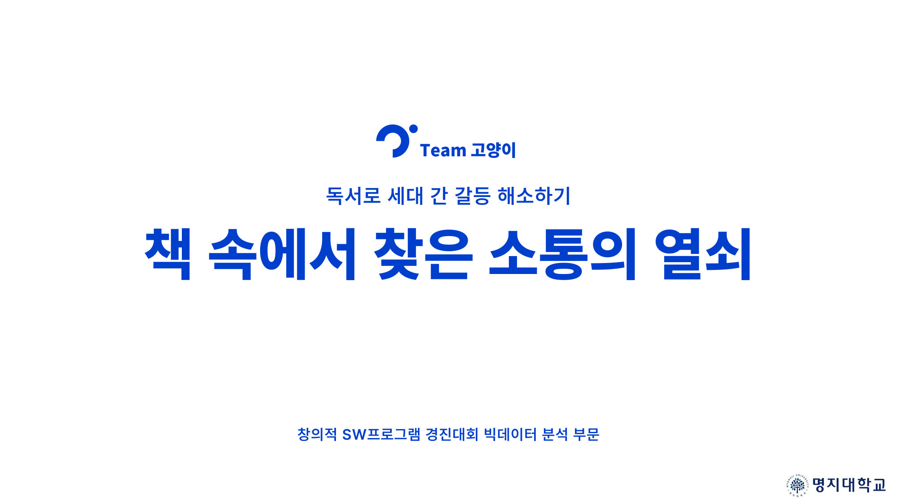
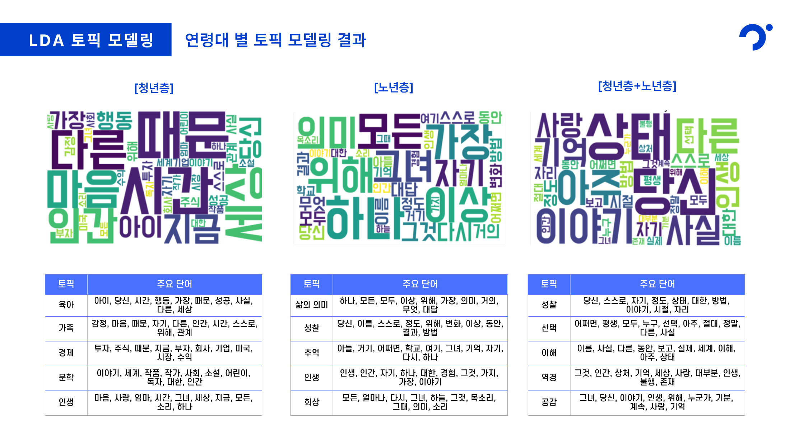
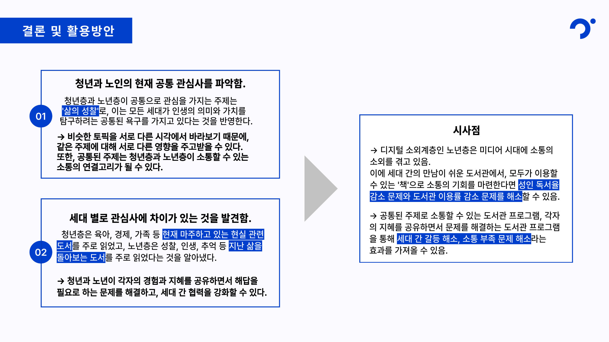
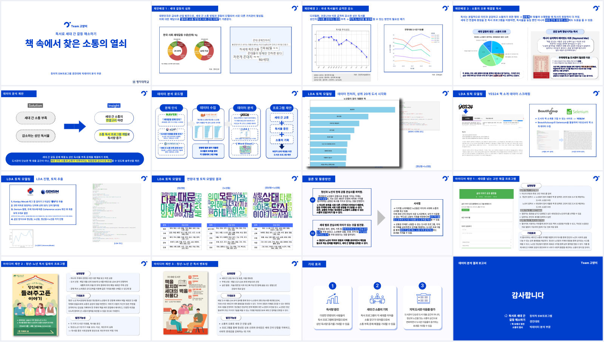
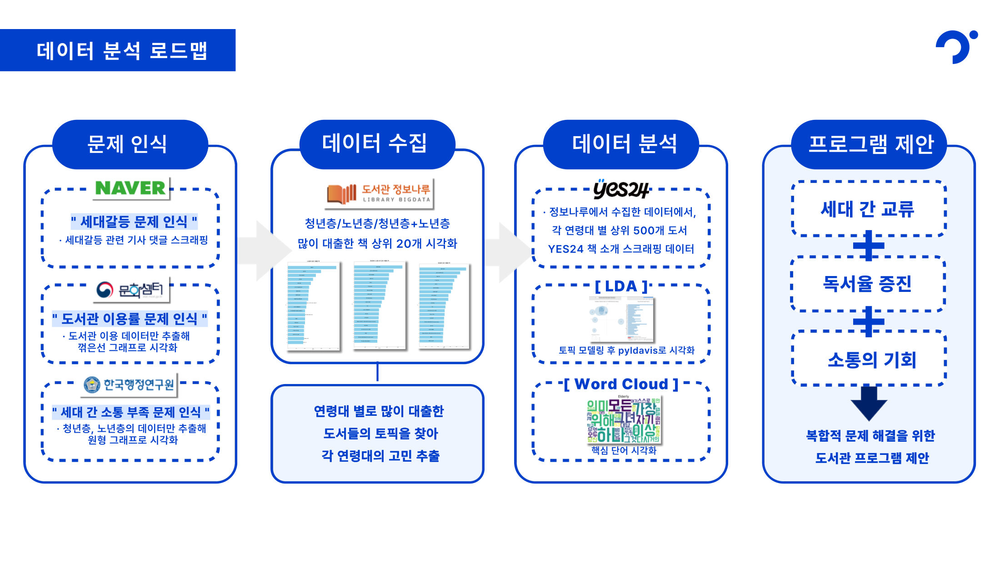
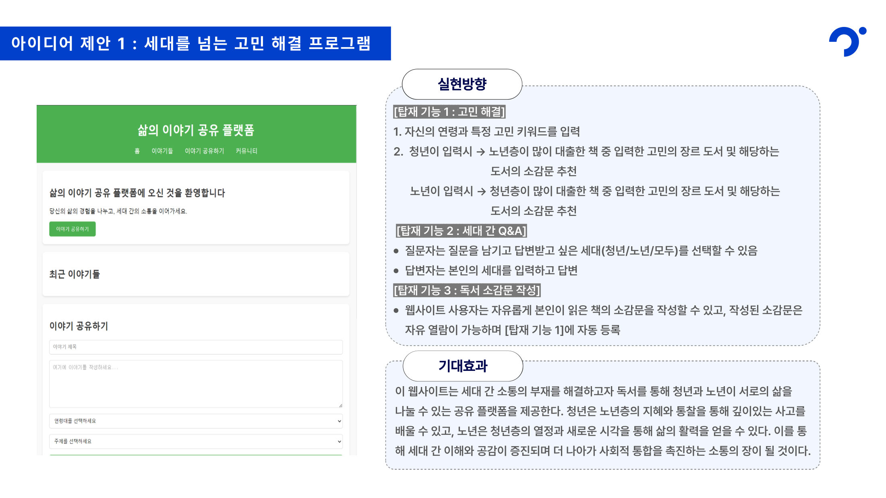

<div align="center">

# 책 속에서 찾은 소통의 열쇠

**연령대별로 많이 빌린 책의 주제를 비교해, 청년층과 노년층을 잇는 도서관 프로그램을 제안한 데이터 분석 프로젝트**

24-1 명지대학교 창의적 SW 경진대회 빅데이터 분석 부문 | Team 고양이

[📄 결과 보고서 (PDF)](docs/데이터%20분석%20결과%20보고서.pdf) | [📝 분석 계획서 (PDF)](docs/데이터%20분석%20계획서.pdf) | [📓 토픽 모델링 노트북](03_토픽모델링)



&nbsp;&nbsp;&nbsp;&nbsp;&nbsp;&nbsp;&nbsp;&nbsp;

</div>

<br>

## 📌 프로젝트 개요

| 항목 | 내용 |
|---|---|
| 기간 | 2024.07.21 ~ 2024.08.15 |
| 인원 | 3명 (Team 고양이) |
| 대회 | 24-1 명지대학교 창의적 SW 경진대회 빅데이터 분석 부문 |
| 결과물 | 데이터 분석 계획서, 결과 보고서, 도서관 프로그램 웹 프로토타입 |

설문에서 20, 30대의 65.8%, 60대 이상의 56%가 세대갈등이 심각하거나 매우 심각하다고 답했다.
두 세대 모두 갈등의 원인을 제도보다 가치관 차이, 상호 이해 부족 같은 **소통의 문제**로 꼽았다.
그런데 공감 능력을 기르는 데 도움이 되는 독서는 오히려 줄고 있다. 성인 독서율은 2002년 72%에서 2021년 47.5%로 떨어졌고, 도서관 이용률도 함께 줄었다.

그래서 두 문제를 함께 풀어 보고 싶었다.
청년층과 노년층이 실제로 어떤 책을 빌려 읽는지 분석해 두 세대의 공통 관심사를 찾고, 이를 연결고리로 삼는 도서관 프로그램을 제안했다.

<br>

## ✨ 분석 단계

| 단계 | 질문 | 방법 | 데이터 |
|---|---|---|---|
| 1. 문제 인식 | 세대갈등과 독서 감소는 얼마나 심각한가 | 설문, 통계 시각화, 세대갈등 기사 댓글 수집 | 한국행정연구원, 국민독서실태조사, 문화셈터, 네이버 뉴스 |
| 2. 데이터 수집 | 세대별로 어떤 책을 많이 빌리는가 | 대출 상위 도서 정제, 상위 20권 시각화, 책 소개 크롤링 | 도서관 정보나루 대출 데이터, YES24 |
| 3. 데이터 분석 | 그 책들은 어떤 주제를 다루는가 | 명사 추출 후 LDA 토픽 모델링, pyLDAvis, 워드클라우드 | 수집한 책 소개 |
| 4. 프로그램 제안 | 분석 결과를 어떻게 쓸 것인가 | 공통/차이 토픽을 바탕으로 세대 통합 프로그램 3종 설계 | 분석 결과 |

### 분석 화면

| 청년층이 많이 대출한 책 | 노년층이 많이 대출한 책 |
|:---:|:---:|
|  |  |
| 대출 1,000건에서 중복을 정리한 상위 20권 | 같은 기준으로 뽑은 노년층 상위 20권 |
| **연령대별 토픽 모델링** | **결론** |
|  |  |
| 세 집단 각각 토픽 5개를 뽑아 워드클라우드로 비교 | 공통 관심사 '삶의 성찰'과 세대별 차이를 정리 |

### 결과 보고서

[](docs/데이터%20분석%20결과%20보고서.pdf)

[전체 보기 (PDF, 16장)](docs/데이터%20분석%20결과%20보고서.pdf)

<br>

## 🏗 분석 흐름

<p align="center"></p>

### 기술 스택

| 구분 | 사용 기술 |
|---|---|
| 데이터 수집 | Selenium, BeautifulSoup, requests |
| 전처리 | pandas, NumPy |
| 텍스트 분석 | KoNLPy (Okt), Gensim (LDA, Coherence), pyLDAvis, WordCloud |
| 시각화 | Matplotlib, Plotly, Spotfire |
| 프로토타입 | HTML, CSS, JavaScript |
| 환경 | Jupyter Notebook |

<br>

## 👥 팀원 및 역할

|  |  |  |
|:---:|:---:|:---:|
| [이예진](https://github.com/Yejineeeee) | [조은비](https://github.com/argente0) | [박서연](https://github.com/seoye8n) |
| 대출 데이터 분석, 토픽 모델링 | 문제 인식 통계 분석 | 세대갈등 원인 분석, 댓글 수집 |

<details>
<summary><b>담당 업무 자세히 보기</b></summary>

**이예진**
- 연령대별 도서관 이용률 분석
- 청년층, 노년층, 공통 대출 데이터 정제와 상위 20권 시각화
- YES24 책 소개 크롤링 (Selenium)
- LDA 토픽 모델링과 워드클라우드, pyLDAvis 시각화
- 도서관 프로그램 웹 프로토타입 제작

**조은비**
- 세대갈등 원인 1순위, 연령대별 세대갈등 수준 시각화
- 2002~2021 성인 독서율 추이 분석
- YES24 연령대별 베스트셀러 탐색 분석

**박서연**
- 세대갈등 원인 1+2순위 분석
- 세대갈등 관련 기사 댓글 수집

</details>

<br>

## 📊 분석 결과

### 대출 데이터

도서관 정보나루에서 청년층(20, 30대), 노년층(60대 이상), 두 세대 공통으로 많이 빌린 책을 각각 1,000건씩 받았다.
같은 책이 시리즈나 판본별로 여러 줄 들어 있어서, 부제를 떼고 서명 기준으로 중복을 지운 뒤 상위 20권을 뽑았다.
이 책들의 소개 글을 YES24에서 수집해 토픽 모델링의 입력으로 썼다.

### 토픽 모델링

```
책 소개 → 한글 외 문자 제거 → Okt 명사 추출 (2글자 이상)
       → 5회 이하 등장 단어, 문서 50% 이상에 나오는 단어 제거 → LDA (토픽 5개)
```

| 집단 | 토픽 |
|---|---|
| 청년층 | 육아, 가족, 경제, 문학, 인생 |
| 노년층 | 삶의 의미, 성찰, 추억, 인생, 회상 |
| 청년층 + 노년층 | 성찰, 선택, 이해, 역경, 공감 |

토픽 이름은 주요 단어를 보고 팀이 직접 붙였다.

### 결론

- **공통 관심사**: 두 세대 모두 '삶의 성찰'을 다룬 책을 많이 읽었다. 같은 주제를 서로 다른 시각에서 보기 때문에 세대 간 대화의 출발점이 될 수 있다.
- **세대별 차이**: 청년층은 육아, 경제, 가족처럼 지금 마주한 현실 문제를, 노년층은 성찰, 인생, 추억처럼 지나온 삶을 돌아보는 책을 주로 읽었다. 서로의 경험이 서로에게 필요한 답이 될 수 있다.

### 프로그램 제안

| 제안 | 내용 |
|---|---|
| 세대를 넘는 고민 해결 플랫폼 | 고민 키워드를 입력하면 다른 세대가 많이 읽은 관련 도서와 소감문을 추천하고, 세대 간 Q&A를 나눈다 ([프로토타입](04_프로그램_제안/도서관%20프로그램)) |
| 청년-노년 독서 릴레이 | 매달 대출 상위 도서의 LDA 토픽으로 주제를 정하고, 같은 주제의 다른 책을 돌려 읽으며 의견을 나눈다 |
| 청년-노년 독서 멘토링 | 공통 토픽의 책을 함께 읽고 토론한 뒤, 고민 상담과 회고록 작성으로 이어간다 |

<p align="center"></p>

<br>

## 🔥 트러블슈팅

<details>
<summary><b>1. 같은 책이 상위권을 여러 번 차지한 문제</b></summary>

- **문제**: 대출 데이터는 권차와 판본이 다르면 다른 책으로 집계되어 있었다. 그대로 상위 20권을 뽑으면 한 시리즈가 여러 자리를 차지해 실제로는 20권보다 적은 책을 분석하게 됐다.
- **해결**: 서명에서 `:` 뒤의 부제를 떼고, 서명 기준으로 중복을 지운 다음 상위 20권을 뽑았다.
- **결과**: 서로 다른 책 20권으로 세대별 순위를 만들 수 있었다.

</details>

<details>
<summary><b>2. 크롤링이 책 한 권 때문에 통째로 멈춘 문제</b></summary>

- **문제**: YES24에서 책 제목으로 검색해 첫 결과의 책 소개를 가져오는 방식이었는데, 검색 결과가 없거나 페이지가 늦게 뜨면 `NoSuchElementException`, `TimeoutException`이 나며 반복문 전체가 멈췄다. 검색 버튼을 id로 찾는 버전에서는 버튼을 못 찾는 오류도 났다.
- **해결**: `time.sleep` 대신 `WebDriverWait`로 요소가 뜰 때까지 기다리고, 책 한 권 단위로 예외를 잡아 실패한 책은 건너뛰고 다음 책으로 넘어가게 바꿨다.
- **결과**: 중간에 멈추지 않고 세 집단 상위 20권의 책 소개를 수집했다. 이 과정에서 시도한 여러 버전의 코드가 노트북에 그대로 남아 있다.

</details>

<details>
<summary><b>3. 막대그래프에서 책 제목이 안 보인 문제</b></summary>

- **문제**: 처음에는 Plotly 세로 막대그래프로 그렸는데, 20권의 긴 제목을 x축에 놓으니 그래프를 읽기 어려웠다.
- **해결**: Matplotlib 가로 막대그래프로 바꾸고 제목을 막대 안에 적었다. 막대가 짧아 제목이 넘치는 책만 막대 오른쪽에 따로 적었다.
- **결과**: 순위와 제목을 한 그래프에서 바로 읽을 수 있게 됐다.

</details>

<details>
<summary><b>4. 토픽 개수를 정하는 문제</b></summary>

- **문제**: 노년층 데이터에서 Coherence score가 가장 높은 토픽 개수는 8개였다. 하지만 같은 분석을 청년층, 노년층, 청년층+노년층 세 번 반복해 나란히 비교해야 했다.
- **해결**: Coherence score가 두 번째로 높은 5개를 골라 세 집단에 똑같이 적용했다.
- **결과**: 세 집단의 토픽을 같은 표에서 나란히 비교할 수 있었다.

</details>

<details>
<summary><b>5. 워드클라우드 한글이 깨진 문제</b></summary>

- **문제**: WordCloud 기본 글꼴에는 한글이 없어 단어가 네모로 나왔다.
- **해결**: 한글 글꼴 파일(`DoHyeon-Regular.ttf`)을 노트북과 같은 폴더에 두고 `font_path`로 지정했다.
- **결과**: 세 집단의 워드클라우드를 같은 글꼴로 만들었다.

</details>

<br>

## 🗂 데이터

| 데이터 | 형식 | 규모 | 출처 |
|---|---|---|---|
| 연령대별 대출 도서 | CSV | 집단별 1,000건 (3개 집단) | 도서관 정보나루 |
| 도서 소개 | CSV, XLSX | 집단별 상위 20권 | YES24 (크롤링) |
| 세대갈등 원인 | CSV | 연령대, 성별 등 35개 집단 | 한국행정연구원 사회통합실태조사 |
| 세대갈등 수준 | CSV | 2022~2023, 35개 집단 | 한국행정연구원 사회통합실태조사 |
| 성인 독서율 | XLSX | 2002~2021 | 국민독서실태조사 |
| 연령대별 도서관 이용률 | CSV | 2013~2021 | 문화셈터 |
| 세대갈등 기사 댓글 | 크롤링 | - | 네이버 뉴스 |

<br>

## 📂 폴더 구조

```
creative_sw_competiton
├── 01_문제인식/
│   ├── 세대갈등_원인/       # 사회갈등 원인 1순위, 1+2순위
│   ├── 세대갈등_수준/       # 연령대별 세대갈등 체감 수준
│   ├── 독서율_추이/         # 2002~2021 성인 독서율
│   ├── 도서관_이용률/       # 연령대별 도서관 이용률
│   └── 기사댓글_크롤링/     # 세대갈등 기사 댓글 수집
├── 02_대출도서_분석/         # 대출 상위 도서 시각화, YES24 책 소개 크롤링
├── 03_토픽모델링/            # LDA (청년층, 노년층, 청년층+노년층)
├── 04_프로그램_제안/         # 고민 해결 플랫폼 웹 프로토타입
├── 기타/                     # 보고서에 쓰지 않은 탐색 분석 (YES24 베스트셀러)
└── docs/                     # 계획서, 결과 보고서, README 이미지
```

<br>

## 🚀 실행 방법

```bash
pip install pandas numpy matplotlib plotly openpyxl konlpy gensim pyLDAvis wordcloud selenium beautifulsoup4 jupyter
jupyter notebook
```

- 각 노트북은 자기 폴더를 기준으로 데이터를 읽는다. 토픽 모델링 노트북은 `02_대출도서_분석`의 결과 CSV를 읽는다.
- KoNLPy는 Java(JDK)가 설치되어 있어야 한다.
- 크롤링 노트북은 당시 로컬 경로의 크롬 드라이버를 쓰도록 되어 있다. 실행하려면 설치된 크롬 버전에 맞는 드라이버 경로로 바꿔야 한다. YES24 페이지 구조가 바뀌어 그대로는 동작하지 않을 수 있어, 수집 결과를 CSV로 함께 올려두었다.
- 웹 프로토타입은 `04_프로그램_제안/도서관 프로그램/index.html`을 브라우저로 열면 된다.

<br>

## ⚠️ 한계

- 집단별 상위 20권의 책 소개만으로 LDA를 돌려 문서 수가 적었고, 토픽이 안정적으로 나오기 어려웠다.
- 불용어 처리가 부족해 토픽 주요 단어에 '당신', '그것', '하나' 같은 일반적인 단어가 많이 남았다.
- 토픽 이름을 사람이 붙였기 때문에 해석에 주관이 들어갈 수 있다.
- 대출 순위는 책의 주제뿐 아니라 화제성, 소장 권수의 영향도 받는다.
- 제안한 프로그램은 실제 도서관에서 운영해 효과를 확인하지는 못했다.

<br>

## 📚 참고

- 문화체육관광부, 국민독서실태조사 (2002~2021)
- 한국행정연구원, 사회통합실태조사
- 세계일보/오픈서베이, 세대갈등 인식 설문조사 (2018)
- Blei, D. M., Ng, A. Y., & Jordan, M. I. (2003). Latent Dirichlet Allocation. Journal of Machine Learning Research, 3, 993–1022.
